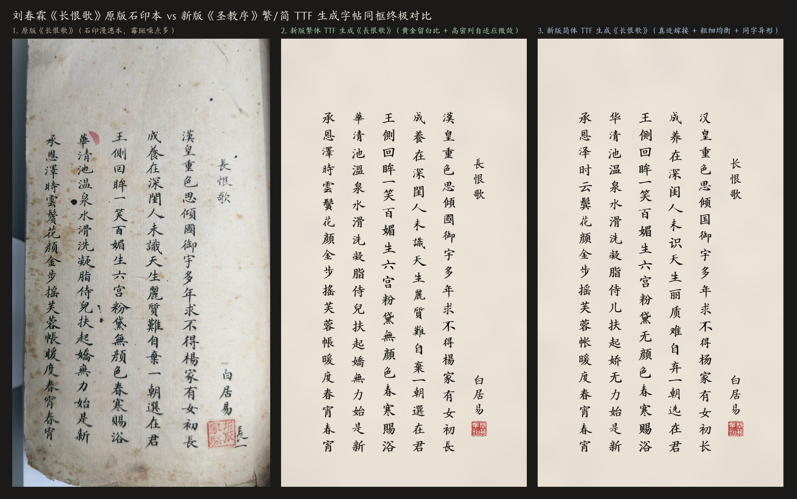
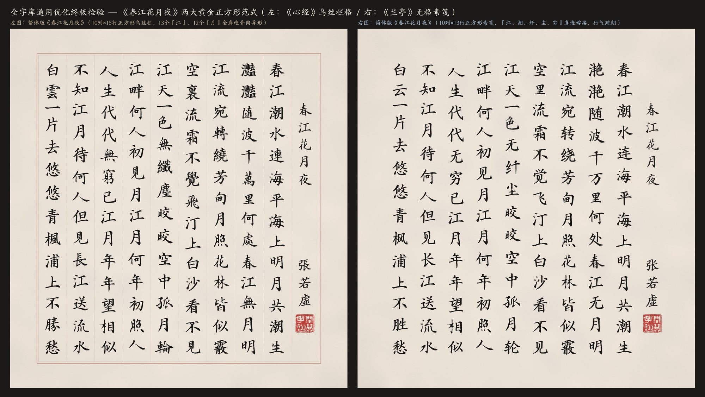
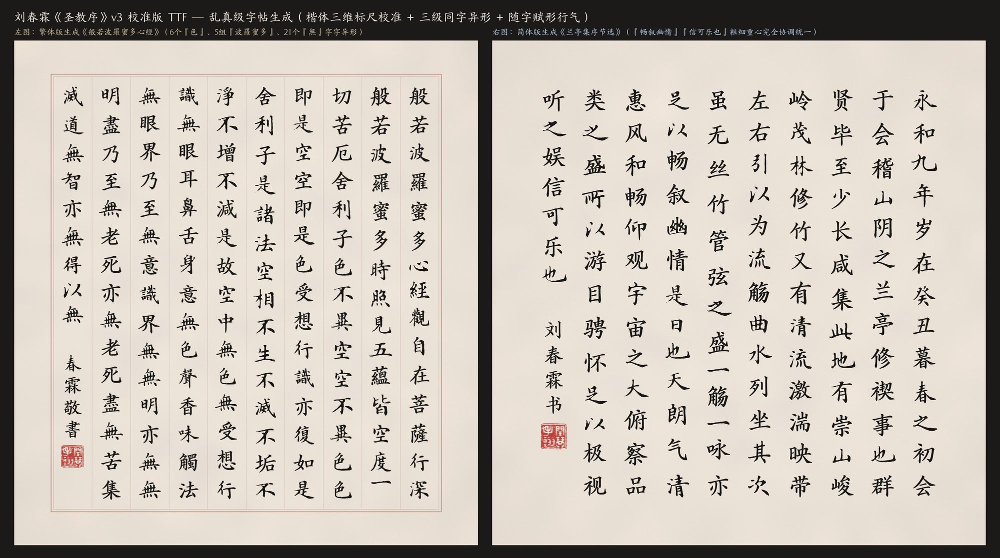
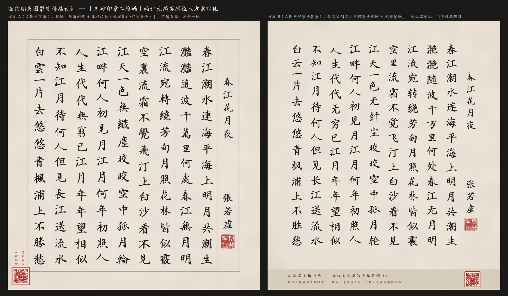
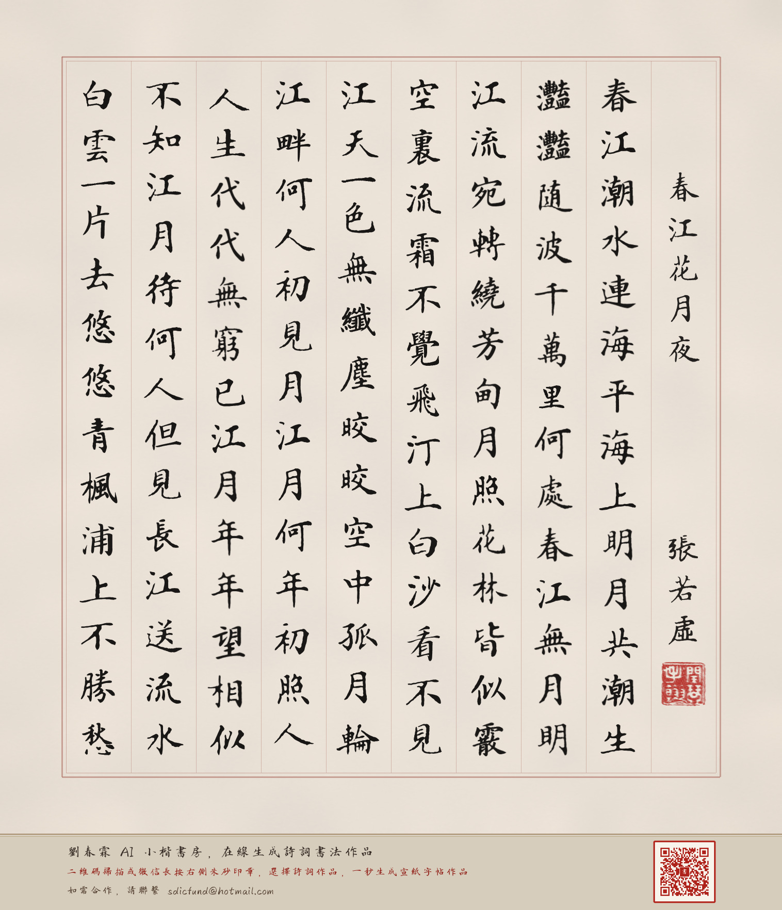
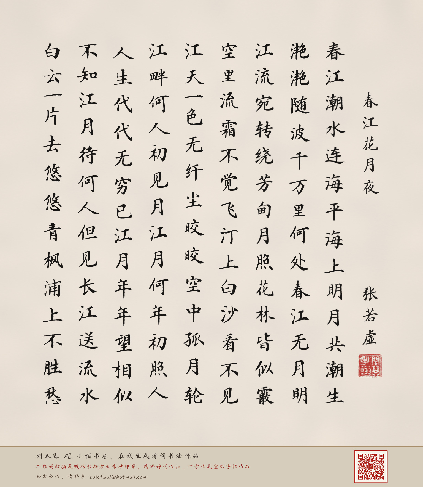
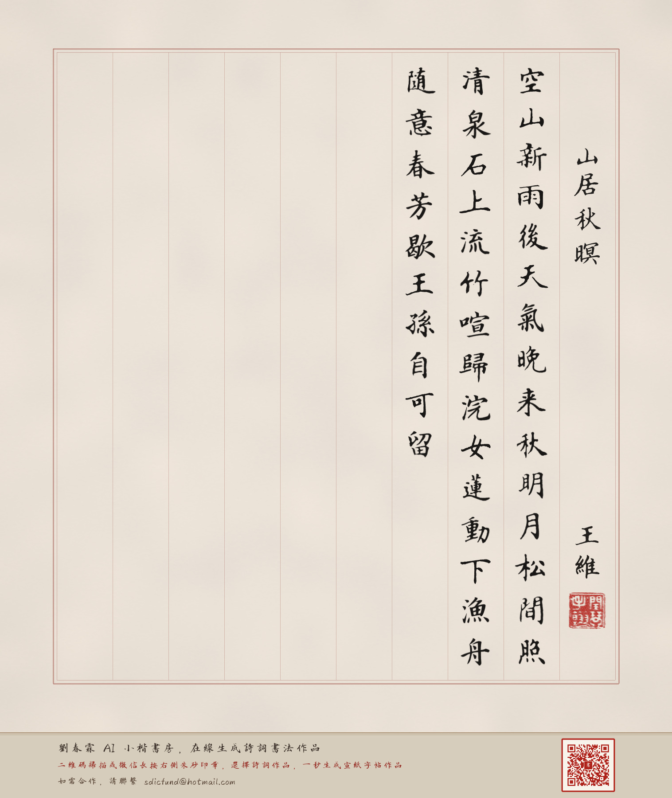
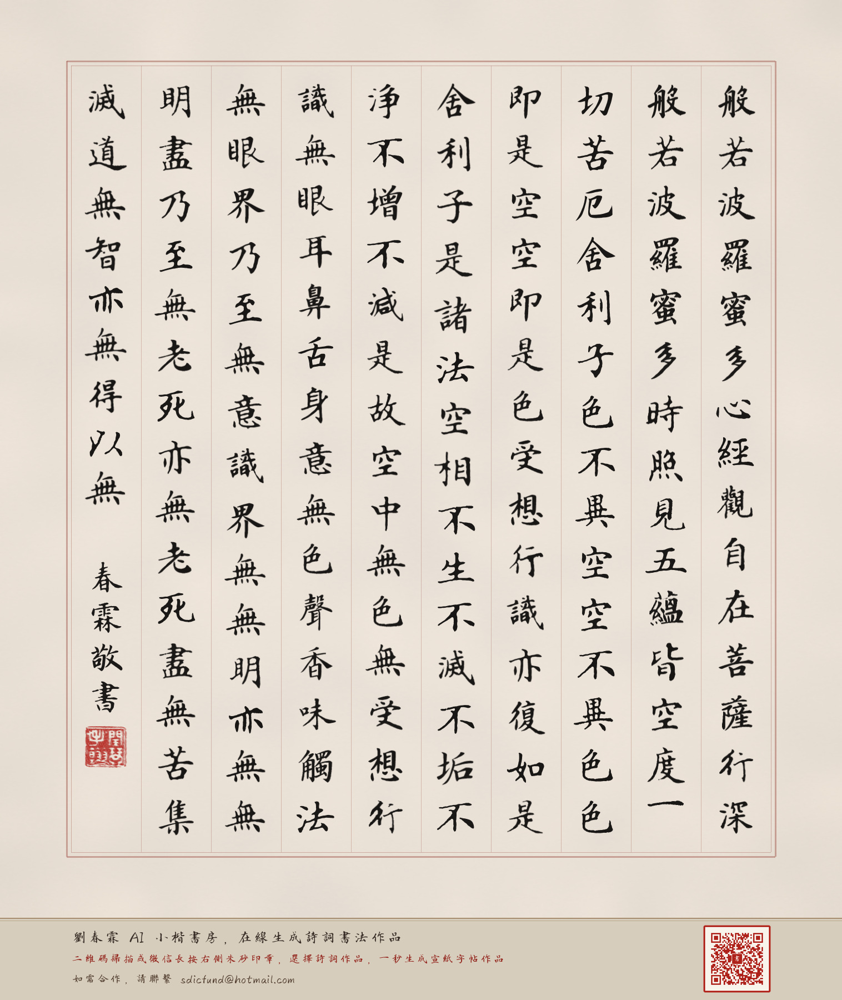
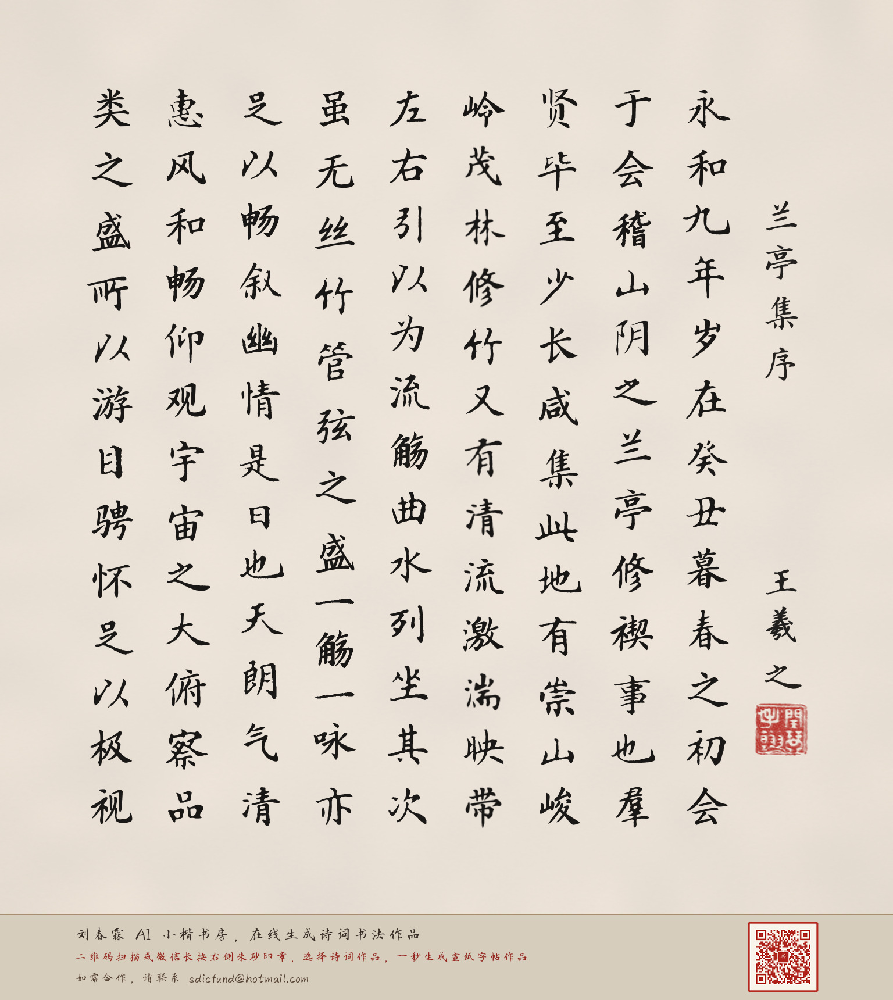

# 刘春霖 AI 小楷书房 · 在线诗词书法生成系统

> 📜 **版权约定：个人免费，商用收费**（详见根目录 [`LICENSE`](LICENSE) 许可协议；如需商业授权或合作，请联系邮箱 `sdicfund@hotmail.com`）
>
> 🌐 **在线体验网站（GitHub Pages 点开即用）**：**[https://dvbs2000.github.io/liuchunlin-shufa/](https://dvbs2000.github.io/liuchunlin-shufa/)**

> [!CAUTION]
> - **⚠️ 防倒卖防受骗警示**：**本字库个人非商用版仅在官方网站免费发放，从未授权任何淘宝、闲鱼、小红书店铺售卖字体文件；在第三方店铺付费购买均属被骗，且不代表获得商业授权。**
> - **🏛️ 国家版权局登记与企业合规授权**：**已具备国家版权局作品登记与区块链存证，可为企业法务开具正式《商业授权证明书》**，直接解决企业、出版社、文创品牌、手机主题商店及影视游戏机构的采购合规痛点（商务合作邮箱：`sdicfund@hotmail.com`）。

---

## 一、核心亮点

1. **状元小楷 · 宣纸真迹神韵**：
   - 基于中国历史上最后一位状元**刘春霖（1872—1944）**传世小楷真迹研发，支持**繁体正统馆阁体**与**简体现代通用馆阁体**。
   - 支持同字异形自然轮换与随字赋形纵向排版，呈现温润典雅的手写书卷气息。
2. **智能题名 / 作者 / 诗词体裁识别**：
   - 粘贴任意诗词或文章（支持首行直接带 `《题名》` 与作者），系统自动识别体裁：
     - **七言古近体诗**：自动采用 **10列×14行** 正方形册页，右侧第 1 列独立低三格排题名 + 作者落款 + 齐脚朱文印，正文每列恰好一联 14 字（单页容量 126 字）。
     - **五言古近体诗**：自动采用 **10列×15行** 正方形册页，右侧第 1 列独立题名落款，正文每列恰好三句 15 字（单页容量 135 字）。
     - **散文 / 经文**：自动顶格起写，于第 10 列篇尾自动落款钤印（单页容量 124~144 字）。
   - 超出单页字数时自动截取第一页容量排版，绝不报错。
3. **故宫文创式宋锦装裱签条 + 微信长按识别朱砂印章二维码**：
   - 每幅生成作品底部自动装裱故宫宋锦底边与「朱砂印章式二维码」，手机微信长按图片即可直接识别二维码进入 **[刘春霖 AI 小楷书房](https://dvbs2000.github.io/liuchunlin-shufa/)** 创作自己的专属诗词书法。

---

## 二、真迹对比与名篇书法作品馆

### 1. 《长恨歌》宣纸真迹 vs AI 小楷复刻对比

---

### 2. 《春江花月夜》繁简双绝全景展示

---

### 3. 《般若波罗蜜多心经》乌丝栏 &《兰亭集序》无格素笺双范式

---

### 4. 故宫宋锦装裱底边 + 朱砂印章二维码设计

---

## 三、在线实时生成单页作品样张（长按右下角朱砂印章可直接扫码体验）

| 《春江花月夜》（繁体 · 乌丝栏带格 · 10×14） | 《春江花月夜》（简体 · 仿古无格素笺 · 10×14） |
| :---: | :---: |
|  |  |

| 《山居秋暝》（五言律诗 · 乌丝栏带格 · 10×15） | 《般若波罗蜜多心经》（繁体 · 乌丝栏带格 · 10×15） |
| :---: | :---: |
|  |  |

| 《兰亭集序》（简体 · 仿古无格素笺 · 10×13） | 版权约定与合作联系 |
| :---: | :---: |
|  | **版权约定**： **个人免费，商用收费**  **在线体验**： [https://dvbs2000.github.io/liuchunlin-shufa/](https://dvbs2000.github.io/liuchunlin-shufa/)  **合作联系**： 如需合作，请联系邮箱 **`sdicfund@hotmail.com`** |

---

## 四、版权与许可协议（License）

本项目实行 **「个人非商业免费 + 商业付费授权」双轨制许可**（详见仓库根目录 [`LICENSE`](LICENSE) 文件）：

- **个人非商业使用（免费）**：个人用户可免费使用在线生成服务及导出的字帖图片，用于个人读书临帖、书法练习及个人非营利社交分享（遵循 `CC BY-NC-ND 4.0` 署名-非商业性使用-禁止演绎原则）。
- **防倒卖警示**：本字库个人非商用版仅在官方网站免费发放，从未授权任何淘宝、闲鱼、小红书店铺售卖字体文件；在第三方店铺付费购买均属被骗，且不代表获得商业授权。
- **商业使用（收费授权 · 可开具正式《商业授权证明书》）**：本字库**已具备国家版权局作品登记与区块链存证，可为企业法务开具正式《商业授权证明书》**。任何企业、机构或个人将本项目或衍生内容用于商业用途（包括但不限于品牌宣传、商品包装、文创销售、图书出版、影视游戏字幕、商业软件/小程序集成、付费课程或自媒体商业变现），必须事先取得作者书面商业授权。
- **商务合作与商业授权联系邮箱**：**`sdicfund@hotmail.com`**
